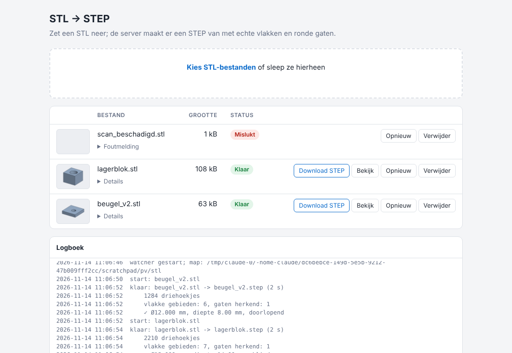
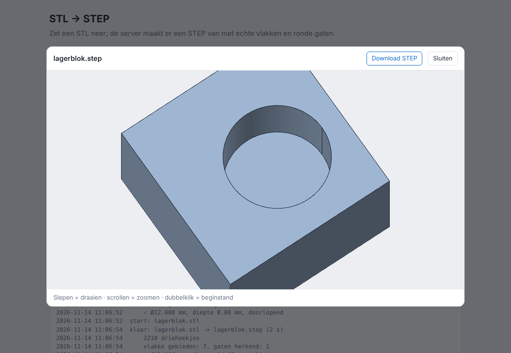
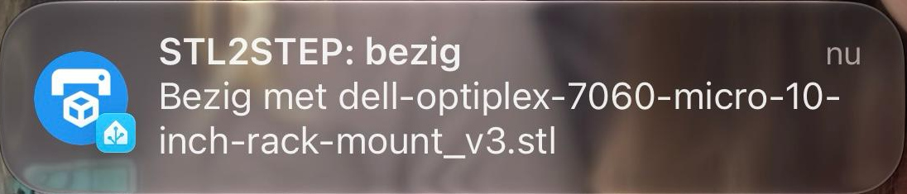
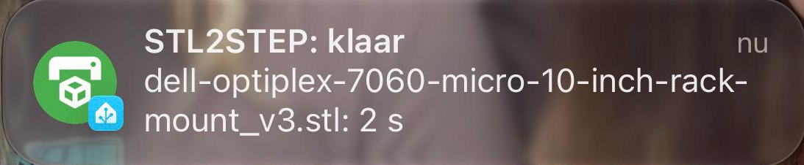
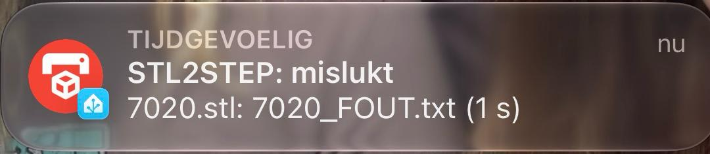

# STL2STEP

Zet STL-bestanden automatisch om naar STEP, met **echte vlakken en echte ronde gaten** in plaats van duizenden driehoekjes. Draait als LXC-container op Proxmox VE, met een netwerkshare en een webpagina.



## Wat het doet

- **Netwerkshare** `\\<ip>\cad` (optioneel, met eigen gebruiker en wachtwoord) met twee mappen: zet een STL in `stl/` en een paar seconden later staat `<naam>.step` in `step/`.
- **Webpagina** op `http://<ip>:8080`: STL's uploaden door te slepen, status per bestand, STEP downloaden, foutmeldingen en logboek.
- **3D-preview**: thumbnail per bestand en een draaibare 3D-weergave in de browser (WebGL2, geen plug-ins).
- **Herkenning** (via FreeCAD, zonder scherm):
  - driehoekjes in hetzelfde vlak worden samengevoegd tot één vlak;
  - ronde gaten (doorlopend en blind) worden herkend en vervangen door een echt cilindervlak, met diameter en diepte in het logboek.
- **Melding via MQTT** (optioneel): na elke conversie `bezig`, `klaar` of `mislukt` op `stl2step/status`, met een sensor in Home Assistant via discovery. Zie [Melding in Home Assistant](#melding-in-home-assistant) voor de automation en screenshots.



## Installeren

Voer dit uit in de **shell van de Proxmox-node** (niet in een container):

```bash
bash -c "$(curl -fsSL https://raw.githubusercontent.com/Martijn5/Stl2Step/main/stl2step.sh)"
```

Het script maakt een Debian 12 LXC aan (standaard 2 cores, 2 GB RAM, 8 GB schijf, DHCP) en installeert alles. Kies "Geavanceerd" voor een eigen container-ID, naam, grootte of vast IP-adres. Aan het eind staan het adres van de webpagina en de share in beeld.

### Bijwerken

```bash
bash -c "$(curl -fsSL https://raw.githubusercontent.com/Martijn5/Stl2Step/main/stl2step.sh)" _ update <container-ID>
```

Of vanuit een kloon van deze repo: `bash stl2step.sh update <container-ID>`. Een kloon gebruikt de lokale code in plaats van GitHub, handig om wijzigingen te testen.

### Zonder Proxmox

In een bestaande Debian 12/13-machine of -container, als root:

```bash
git clone https://github.com/Martijn5/Stl2Step && bash Stl2Step/install/install.sh
```

## Gebruik

| Waar | Wat |
|---|---|
| `stl/` of de uploadknop | STL neerzetten; conversie start zodra het kopiëren klaar is |
| `step/<naam>.step` | het resultaat |
| `step/<naam>_FOUT.txt` | reden als een conversie mislukt |
| `step/conversie.log` | logboek met per bestand de herkende gaten |

Opnieuw omzetten: overschrijf de STL, verwijder de STEP, of klik op **Opnieuw** op de webpagina.

## Beperkingen

- Alleen **vlakken en rechte, volledig ronde gaten** worden omgezet. Uitstekende pennen, sleuven, afrondingen, verzinkingen en kegelvormige boorpunten blijven facetten (dat staat in het logboek).
- De STL moet **gesloten (waterdicht)** zijn en in **mm**.
- Grote STL's (meer dan ~50.000 driehoekjes) kunnen minuten duren.
- De **webpagina** heeft geen wachtwoord. De firewall van de container laat alleen je eigen LAN toe (webpagina en, als je Samba kiest, de share). Niet openzetten naar internet.

## Opbouw

```
stl2step.sh            Proxmox-script: maakt de LXC aan en installeert (of werkt bij)
install/install.sh     installatie binnen de container: pakketten, diensten, Samba
src/convert.py         herkenning (numpy) + bouwen en exporteren (FreeCAD), draait onder freecadcmd
src/watcher.py         bewaakt stl/, roept convert.py aan per bestand  (dienst stl2step)
src/web.py             webpagina en API, alleen Python-standaardbibliotheek (dienst stl2step-web)
tests/                 tests voor de herkenning (alleen numpy nodig)
```

In de container staat de code in `/opt/stl2step`, de bestanden in `/srv/cad`. Logboek van de diensten: `journalctl -u stl2step -u stl2step-web -f`.

### Tests

```bash
pip install numpy pytest
pytest tests
```

De herkenning wordt getest op gegenereerde meshes. Het FreeCAD-deel (solid bouwen, snijden, STEP en preview exporteren) heeft een echte FreeCAD-installatie nodig en zit niet in de tests.

## Melding in Home Assistant

STL2STEP kan na elke conversie een bericht sturen via MQTT. Home Assistant maakt daar
automatisch een sensor van, en met de automation hieronder krijg je een melding op je telefoon.

### 1. Wat je nodig hebt

- Een MQTT-broker (bijv. Mosquitto) die Home Assistant al gebruikt.
- Een eigen MQTT-gebruiker voor STL2STEP die alleen zijn eigen topics mag schrijven.
  Voorbeeld voor het ACL-bestand van Mosquitto:
  ```
  user stl2step
  topic write stl2step/#
  topic write homeassistant/sensor/stl2step/#
  ```
- Bij de installatie (`bash stl2step.sh` of `bash stl2step.sh update <id>`) kies je **Ja** bij
  "Melding via MQTT" en vul je broker, gebruiker en wachtwoord in.

### 2. De sensor

Na het starten van de dienst verschijnt in Home Assistant vanzelf `sensor.stl2step`
(via MQTT discovery). Status: `bezig`, `klaar` of `mislukt`, met als attributen:

| attribuut | voorbeeld |
|---|---|
| `bestand` | `blok.stl` |
| `tekst` | `12 s`, of de foutmelding |
| `tijd` | `2026-11-27T12:00:00` |

Topic: `stl2step/status` (JSON, retained).

### 3. De automation

Instellingen > Automatiseringen en scènes > **+ Automatisering maken** > Nieuwe automatisering >
menu (drie puntjes) rechtsboven > **Bewerken in YAML**, en plak dit erin.

Pas twee dingen aan:
- `notify.mobile_app_JOUW_TELEFOON`: je eigen telefoon. Zoek hem op via
  Ontwikkelhulpmiddelen > Acties, typ `notify.mobile_app`.
- `webpagina`: het adres van je STL2STEP-container.

```yaml
alias: STL2STEP melding
description: Eén melding per conversie die meegaat van bezig naar klaar of mislukt
mode: queued
triggers:
  - trigger: state
    entity_id: sensor.stl2step
conditions:
  # niet melden bij het opstarten van HA of als de sensor even weg is
  - condition: template
    value_template: >-
      {{ trigger.from_state is not none
         and trigger.from_state.state not in ['unknown', 'unavailable']
         and trigger.to_state.state in ['bezig', 'klaar', 'mislukt'] }}
actions:
  - variables:
      status: "{{ trigger.to_state.state }}"
      bestand: "{{ trigger.to_state.attributes.bestand }}"
      tekst: "{{ trigger.to_state.attributes.tekst }}"
      icoon: "{{ {'bezig': '⏳', 'klaar': '✅', 'mislukt': '❌'}[status] }}"
      webpagina: "http://IP-VAN-JE-CONTAINER:8080"
  - action: notify.mobile_app_JOUW_TELEFOON
    data:
      title: "{{ icoon }} STL2STEP {{ status }}"
      message: >-
        {{ bestand }} wordt omgezet naar STEP…
        {{ bestand }} is klaar ({{ tekst }})
        {{ bestand }}: {{ tekst }}
      data:
        tag: stl2step                      # zelfde tag = deze melding vervangt de vorige
        group: stl2step                    # meldingen van STL2STEP bij elkaar
        subtitle: "{{ bestand }}"          # iPhone: tweede regel onder de titel
        url: "{{ webpagina }}"             # iPhone: tikken opent de webpagina
        clickAction: "{{ webpagina }}"     # Android: tikken opent de webpagina
        notification_icon: mdi:printer-3d  # Android: eigen icoon (iPhone toont altijd het HA-icoon)
        color: "{{ {'bezig': '#2196F3', 'klaar': '#4CAF50', 'mislukt': '#F44336'}[status] }}"   # Android
        push:
          sound: "{{ 'none' if status == 'bezig' else 'default' }}"     # bezig: stil
          interruption-level: "{{ {'bezig': 'passive', 'klaar': 'active', 'mislukt': 'time-sensitive'}[status] }}"
```

### Wat je krijgt

  

- ⏳ **bezig**: stil, zonder geluid.
- ✅ **klaar**: vervangt de bezig-melding, met geluid.
- ❌ **mislukt**: als *tijdgevoelig*, zodat hij ook door een focusmodus heen komt.
- Tikken op de melding opent de webpagina.

Alleen bij fouten een melding? Zet in de voorwaarde `['mislukt']` in plaats van
`['bezig', 'klaar', 'mislukt']`.

## Licentie

GPL-3.0, zie [LICENSE](LICENSE).
